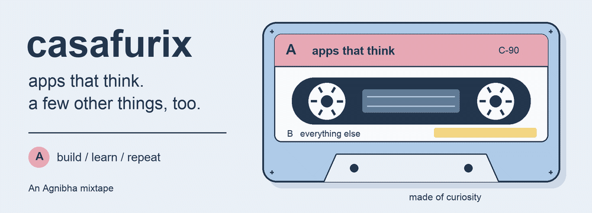

  

# やあ、agnibha です

**AI engineer. Building and shipping apps that think.**

Gen AI, deep learning, and the bit where a model becomes something you can
actually use. Based in Hsinchu, Taiwan.

## Side A · things I've been building

| On the tape | What you'll find |
| :--- | :--- |
| [BodhiX Voice RAG](https://github.com/casafurix/bodhix-voice-rag) | Speak a question, get a grounded answer. Multilingual retrieval, citations, and a visible guardrail trace. |
| [Language Text Summarizer](https://github.com/casafurix/Language-Text-Summarizer) | An end-to-end ML app for text summaries, with Hindi support. |
| [TESimuLA](https://github.com/casafurix/TESimuLA) | A self-driving car simulation. Neural nets in JavaScript, without libraries :)) |

## Side B · still learning, still curious

Swift & iOS dev. Japanese. Music.

Some days it's a model. Some days it's a melody. Some days it's remembering
which Japanese particle goes where.

A tiny Japanese checkpoint

**まだ勉強中です。**

*Mada benkyō-chū desu.* — I'm still learning.

Applies to Japanese. Also applies to pretty much everything here.

---

**Let's make something interesting.** Always down to collaborate on AI apps,
language tools, or a good weird idea.

[Find me on X](https://x.com/casafurixmusic) ·
[Explore the repos](https://github.com/casafurix?tab=repositories)

Handmade mixtape. The animation plays once; here's the [still version](./assets/mixtape.png).
